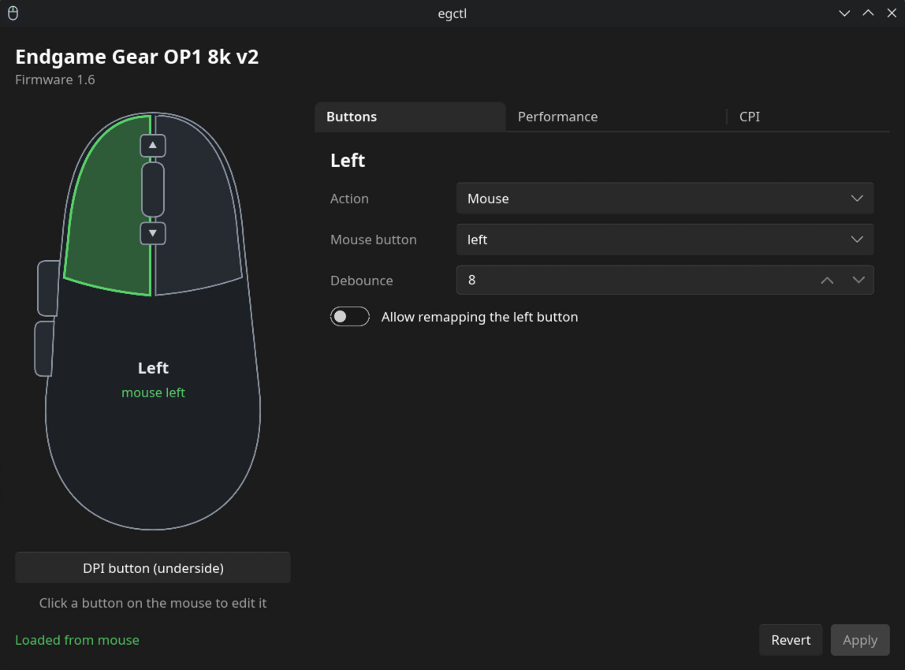

# egctl: Endgame Gear OP1 8k v2 on Linux

Configure the **Endgame Gear OP1 8k v2** gaming mouse on Linux: DPI, polling rate up to 8000 Hz, lift-off settings and button remapping, from a desktop app or the command line. No Windows needed.

This is a fork of [egctl by Creations](https://heliopolis.live/creations/egctl) that adds:

- **egctl-gui**: a desktop app with a clickable mouse diagram
- **A fix for the button layout** on firmware 1.6: 8 buttons at offset 71 (the original read 7 buttons from the wrong place, so every mapping showed on the wrong button)
- **Button names** `dpi`, `wheel-up` and `wheel-down` in the CLI
- **CPI cycle** saved with its factory value (`0xf1`) instead of `0`



## Features

- Read and display all current settings
- Polling rate (1000 / 2000 / 4000 / 8000 Hz)
- DPI per level, number of active levels
- Angle snapping, ripple control, motion sync, glass mode, force max fps
- Slamclick and jitter filters
- Remap any of the 8 buttons to a mouse button, scroll, keyboard key or combo, media key, CPI cycle, CPI shift, or disable it
- Per-button debounce
- GUI: unsaved-changes indicator, Revert, and a safety lock so the left button can't stop being left-click by accident

## Install

### 1. Install the build dependencies

**Fedora**
```
sudo dnf install cargo git systemd-devel fontconfig-devel libxkbcommon-devel
```

**Ubuntu / Debian**
```
sudo apt install git pkg-config libudev-dev libfontconfig-dev libxkbcommon-dev
```
Then install Rust from [rustup.rs](https://rustup.rs). The `cargo` in apt is often too old.

**Arch**
```
sudo pacman -S rust git systemd-libs fontconfig libxkbcommon pkgconf
```

### 2. Build and install

```
git clone https://github.com/luk3h/egctl.git
cd egctl
./install.sh
```

This installs `egctl` and `egctl-gui` to `~/.local/bin`, adds **egctl** to your app menu, and installs the udev rule so it works without root. It asks for your password once, for the udev rule only.

**Unplug and replug the mouse** after the first install.

### CLI only

If you don't want the GUI (and its larger build):
```
cargo install --path . --locked
sudo cp 60-endgamegear.rules /etc/udev/rules.d/
sudo udevadm control --reload-rules && sudo udevadm trigger
```

### Updating

```
cd egctl
git pull
./install.sh
```

### Uninstalling

```
./uninstall.sh
```

## Usage

### GUI

Open **egctl** from your app menu, or run `egctl-gui`.

- Click a button on the mouse drawing to edit it. Hover any button to see its current mapping.
- Changed buttons get an amber dot. Nothing is written until you press **Apply**.
- **Revert** reloads everything from the mouse.

### CLI

```
egctl info                         show all settings
egctl rate 4000                    polling rate
egctl dpi 1600                     DPI for level 1
egctl dpi 800 --level 2            DPI for level 2
egctl dpi -x 800 -y 1600           separate X/Y
egctl dpi-levels 2                 number of active levels
egctl angle-snap on
egctl ripple off
egctl motion-sync on
egctl filter slamclick on
egctl filter jitter off
egctl debounce left 8
egctl spdt left speed
egctl bind forward key f5
egctl bind back media play-pause
egctl bind wheel-up media volume-up
egctl bind dpi cpi 400
egctl bind dpi cpi-loop
egctl keys                         list key names
egctl dump                         raw settings, for bug reports
egctl reset                        factory reset
```

### Button names

| Name | Number | Button |
|---|---|---|
| `left` | 1 | Left click |
| `right` | 2 | Right click |
| `middle` | 3 | Wheel click |
| `forward` | 4 | Front side button |
| `back` | 5 | Rear side button |
| `dpi` | 6 | DPI button (underside) |
| `wheel-up` | 7 | Scroll up |
| `wheel-down` | 8 | Scroll down |

Keys can be names (`a`, `enter`, `f5`; see `egctl keys`), combos (`ctrl+c`, `ctrl+shift+esc`) or raw HID codes (`0x14`).

## If something goes wrong

If a button stops working after a change, fix it from a terminal:
```
egctl bind left mouse left
```
or reset the mouse to factory settings with `egctl reset`.

## Tested on

- OP1 8k v2, firmware 1.6, Fedora 44 KDE

If yours behaves differently, please open an issue with your firmware version and the output of `egctl dump`.

## Credits

Original egctl by [Creations](https://heliopolis.live/creations/egctl). GUI and fixes by [luk3h](https://github.com/luk3h).

## License

AGPL-3.0-or-later, the same as the original project.
